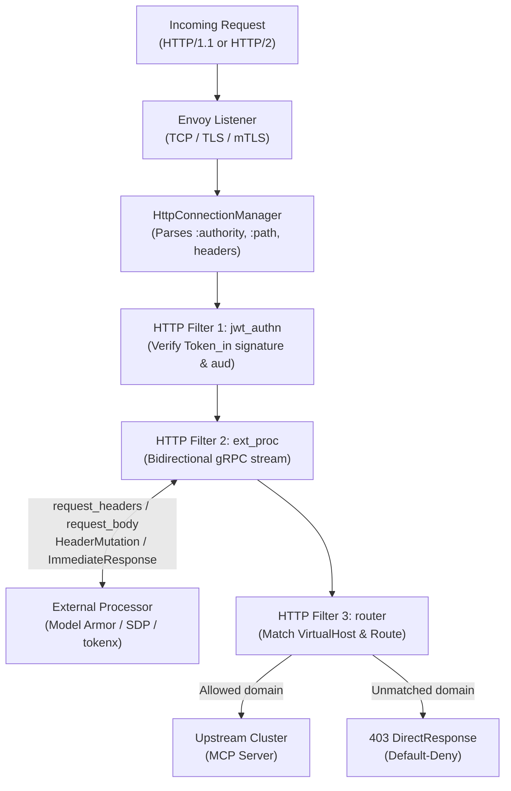

# Envoy Proxy Mechanics & How Google Cloud Agent Gateway Relates to It

This learning guide explains how **Envoy Proxy** works under the hood in **Track A (self-managed sidecar)** and how **Google Cloud Agent Gateway** in **Track B** implements the same data-plane concepts as a managed service.

---

## 1. How Envoy Proxy Processes a Request

Envoy is an L4/L7 proxy built around four composable building blocks:

1. **Listener (`0.0.0.0:8080` or `127.0.0.1:15001`):** Accepts TCP (and optional TLS/mTLS) connections.
2. **Filter Chain & `HttpConnectionManager` (HCM):** Terminates HTTP/1.1 or HTTP/2, parses `:authority` / `:path` / headers, and runs an ordered list of **HTTP Filters**.
3. **HTTP Filters (executed sequentially per request/response):**
   - `envoy.filters.http.jwt_authn` — verifies JWT signatures against remote JWKS (`iss`, `aud`, `exp`) before application code sees the request.
   - `envoy.filters.http.ext_authz` — makes a fast allow/deny decision (headers-only or metadata).
   - `envoy.filters.http.ext_proc` — opens a **bidirectional gRPC stream** (`ExternalProcessor.Process`) to an out-of-process helper. At each lifecycle event (`request_headers`, `request_body`, `response_headers`, `response_body`), Envoy pauses, sends the data to `ext_proc`, and applies returned `HeaderMutation` / `BodyMutation` / `ImmediateResponse` (e.g., `403` block) instructions.
   - `envoy.filters.http.router` — final filter that matches `virtual_hosts` / `routes` and forwards to an upstream **Cluster**.
4. **Cluster:** Defines upstream endpoints, DNS resolution, TLS/mTLS settings, and connection pooling.

---

## 2. How Track A Uses Envoy Directly ("Glass-Box")

In Track A (`services/envoy_sidecar/`):

- **Ingress Envoy (`envoy-ingress.yaml`, port `8080`):** Runs `jwt_authn` (validates `Token_in` with `aud=web-app`) and `ext_proc` (screens prompts with Model Armor), then forwards to the ADK app on `127.0.0.1:8081`.
- **Egress Envoy (`envoy-egress.yaml`, port `15001`):** Enforces a **default-deny domain allowlist** (`orders-read-mcp.internal`, `orders-write-mcp.internal`, returning `403` for everything else) and invokes `ext_proc` (`ext_proc_server.py`) to rewrite `Authorization` with `Token_obo` so `Token_obo` never enters the agent container.

---

## 3. How Google Cloud Agent Gateway Maps to Envoy

Google Cloud's **Agent Gateway** is a declarative AI-protocol governance layer (`MCP` / `A2A`) that configures an Envoy-based data plane in one of two deployment models:

- **Google-Managed (`googleManaged`):** Google Cloud automatically provisions and runs the underlying Envoy-based transparent forward proxy in a managed tenant project, connected to `AgentRuntime` (`reasoningEngines`) over Private Service Connect (`240.0.0.2:443`). This is what **Track B** uses (`AGENT_TO_ANYWHERE`).
- **Self-Managed (`selfManaged`):** You attach the `AgentGateway` configuration to an existing Google Cloud Envoy-based proxy that you already operate in your project:
  - **`CLIENT_TO_AGENT` (inbound):** Cloud Application Load Balancer (L7 ILB / XLB) or GKE Gateway.
  - **`AGENT_TO_ANYWHERE` (outbound):** Secure Web Proxy (SWP), which acts as a transparent forward proxy.

In both models, the Agent Gateway control plane translates your `AgentRegistry` entries, `AuthzPolicy` rules, and `AuthzExtension` callouts into Envoy's listener, TLS inspection, routing, and `ext_proc` filters:

| Self-Managed Envoy Concept (Track A) | Google-Managed Agent Gateway Equivalent (Track B) | What Happens Under the Hood |
| :--- | :--- | :--- |
| **Egress Listener (`127.0.0.1:15001`)** | **Synthetic IP (`240.0.0.2:443`) + SPIFFE mTLS** | `AgentRuntime` routes outbound HTTPS (`ALL_TRAFFIC` or `PRIVATE_RANGES_ONLY`) to `240.0.0.2:443` with an Agent Identity SPIFFE client cert. |
| **TLS Inspection** | **Managed Gateway Inspection CA (`agentGatewayCard.rootCertificates`)** | Gateway terminates TLS, inspects SNI (`mcp.spike.internal`), and re-encrypts upstream using `AgentConnectivityTemplate.egressNetworkConfig.tlsConfig` (`TrustConfig` + `PUBLICLY_TRUSTED_ROOTS`). |
| **VirtualHost Domain Allowlist** | **Agent Registry + `AuthzPolicy` / UAP Policy V2** | Unmatched / unauthorized SNIs are dropped at the gateway (`default_denied`), logging `enforcedGatewaySecurityPolicy` to Cloud Logging. |
| **`envoy.filters.http.ext_proc`** | **`AuthzExtension` + `AuthzPolicy` (`action: CUSTOM`)** | Gateway opens a bidirectional `ext_proc` gRPC stream over TLS (`--protocol=HTTP2` backend service) to your `ext_proc` service (or Model Armor). |
| **Cluster DNS & Private VPC Routing** | **`AgentConnectivityTemplate` (`dnsPeeringConfig` + `networkAttachment`)** | Gateway resolves private FQDNs via Cloud DNS peering (`spike.internal.`) and sends traffic into your VPC over the `/26` PSC-I Network Attachment (`10.10.1.0/26`). |

### Key Behavioral Nuance Verified in the Spike

- **`policyProfile: REQUEST_AUTHZ`** configures the gateway's `ext_proc` filter to inspect **`REQUEST_HEADERS` only**. Returned `HeaderMutation`s (rewriting `Authorization` and adding custom headers) apply cleanly while the JSON-RPC request body streams straight through (`HTTP 200`).
- **`policyProfile: CONTENT_AUTHZ`** additionally sends **`REQUEST_BODY`** over `ext_proc` (intended for payload inspection such as Model Armor).
- **`ExtensionBinding` / `ProducerExtension`** (Early Preview) currently targets `self_managed` gateways and `AI_APPLICATION` scopes, not `googleManaged` `AgentGateway`.
